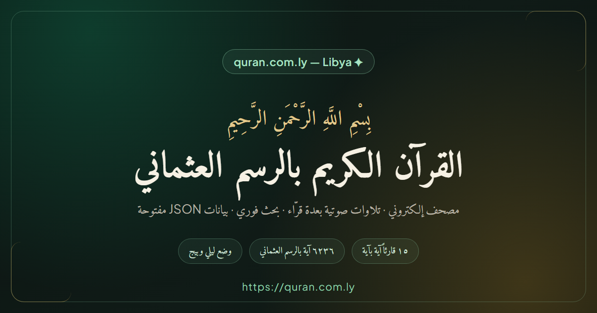

# القرآن الكريم بالرسم العثماني — quran.com.ly



مصحف إلكتروني وقاعدة بيانات مفتوحة المصدر للقرآن الكريم بالرسم العثماني، منشور على **[quran.com.ly](https://quran.com.ly/)**.

## الشكر والفضل

بدأ المشروع بفكرة وهيكل مبدئي بسيط، وبمساعدة أدوات **Google AI Studio** في جلب بيانات القرآن الكريم بصيغة JSON فقط. بعد ذلك أُكمل تطوير المشروع وتخصيصه وتوسيعه وصيانته بالكامل من صاحب المشروع: واجهات القراءة، والتلاوات الصوتية بعدة قرّاء، والسمات، والبحث، والعلامات المحفوظة، والبيانات الوصفية للسيو، وغيرها. الإشارة إلى أدوات جوجل هنا هي شكر على المساعدة الأولية في جلب الملفات، ولا تعني ملكيتها للمشروع أو استمرار اعتماد المشروع عليها.

## المزايا

- **نص القرآن كاملًا**: ٦٢٣٦ آية بالرسم العثماني موزّعة على ١١٤ سورة، بصيغة JSON.
- **تلاوات صوتية آية بآية**: ١٥ قارئًا (العفاسي، الحصري، المنشاوي، عبد الباسط، السديس، الشاطري، الحذيفي، المعيقلي، محمد أيوب، العجمي، جبريل، الشريم، بصفر، الرفاعي…)، مع تتبّع الآية آية بآية وزرّي التالي/السابق وتكرار الآية.
- **فهرس السور**: بحث بالاسم أو الرقم، وتصفية مكية/مدنية.
- **وضعان للقراءة**: آية بآية، وقراءة متصلة على شكل المصحف.
- **بحث فوري** في جميع الآيات مع تجاوز التشكيل.
- **علامات مرجعية** محفوظة في المتصفح.
- **السمات**: وضع ليلي (افتراضي) ووضع بيج مريح للعين، مع حفظ الاختيار.
- **الخطوط**: تضمين خطوط مجمع الملك فهد لطباعة المصحف الشريف (TTF) مع مبدّل خطوط وتحكّم بحجم الخط.
- **مستودع البيانات**: معاينة JSON، وهيكليته، وأكواد استخدام (JavaScript/Python/cURL/CSS/Flutter/React Native)، وتنزيل `quran.json` و`quran-by-surah.json`.
- **تحسين محركات البحث**: وصف ونطاق وبيانات منظّمة JSON-LD، وصورة مشاركة، و`sitemap.xml` و`robots.txt` و`site.webmanifest` وأيقونة الموقع.

## التقنيات

React 19 · TypeScript · Vite · Tailwind CSS 4 · lucide-react

## التشغيل محليًا

```bash
npm install
npm run dev        # خادم التطوير على http://localhost:3000
npm run build      # بناء الإنتاج إلى مجلد dist
npm run preview    # معاينة نسخة الإنتاج
npm run lint       # فحص الأنواع (tsc)
```

## بنية المشروع

```
├── index.html                  # نقطة الدخول والبيانات الوصفية للسيو
├── src/
│   ├── App.tsx                 # الحالة الرئيسية ومحرّك التلاوة
│   ├── components/             # واجهات المصحف والبحث والبيانات
│   ├── utils/                  # مساعدات النص العربي وقائمة القرّاء
│   └── assets/data/            # نسخة من بيانات القرآن للاستيراد المحلي
├── public/
│   ├── assets/data/            # بيانات القرآن والأصول التي تُخدَم للزائر
│   ├── assets/fonts/           # خطوط KFGQPC المضمّنة
│   ├── _redirects              # إعادة توجيه SPA على Cloudflare Pages
│   ├── robots.txt / sitemap.xml
│   └── og-image.png            # صورة المشاركة الاجتماعية
└── scripts/generate_quran_data.mjs  # توليد ملفات JSON من المصدر المفتوح
```

## مصادر البيانات والتلاوات

- **نص القرآن**: بيانات مشروع [quran-json](https://github.com/risan/quran-json) المفتوح المصدر (الرسم العثماني، ٦٢٣٦ آية).
- **التلاوات الصوتية**: تلاوات آية بآية من [شبكة islamic.network](https://islamic.network/).
- **الخطوط**: خطوط مجمع الملك فهد لطباعة المصحف الشريف، وخطوط Amiri / Amiri Quran و Plus Jakarta Sans، وجميعها **مضمّنة محلياً** داخل المشروع (رخصة SIL Open Font License) دون الاعتماد على أي خدمة خطوط خارجية.

## النشر

الموقع منشور عبر **Cloudflare Pages**:

- أمر البناء: `npm run build`
- مجلد الإخراج: `dist`
- إصدار Node: محدّد في `.node-version`
- إعادة توجيه المسارات إلى `index.html` عبر `public/_redirects`

## الترخيص

هذا المشروع مرخّص تحت رخصة MIT — راجع ملف [LICENSE](LICENSE).
